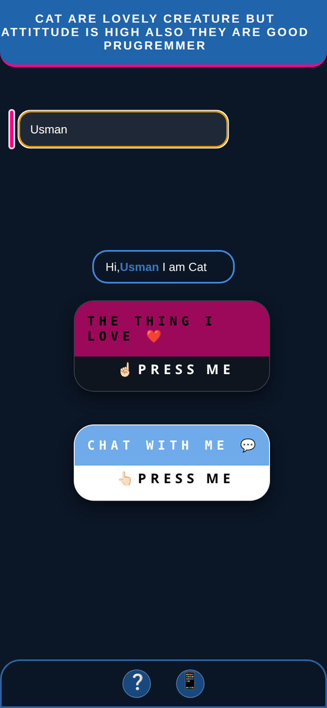
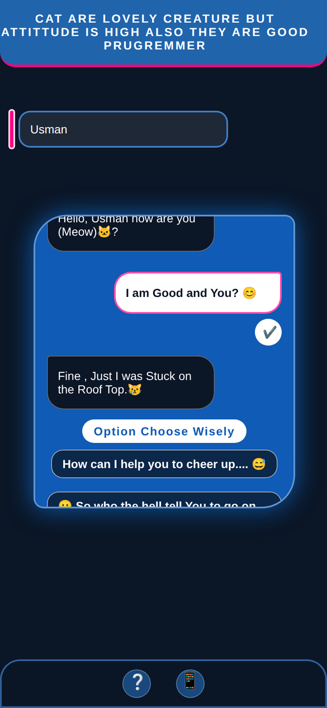
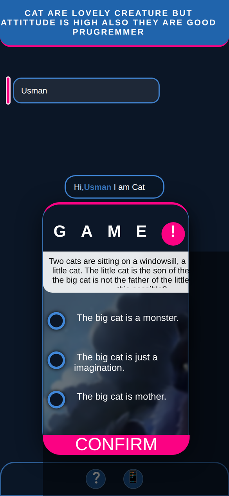
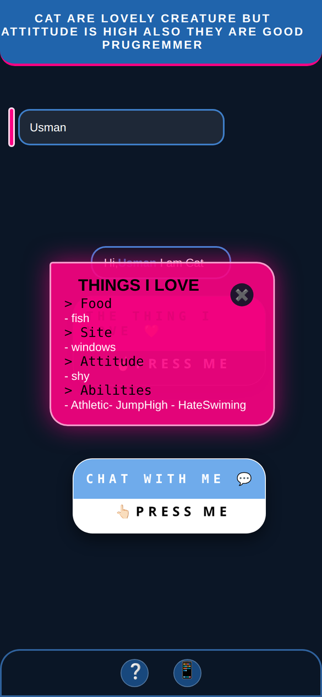
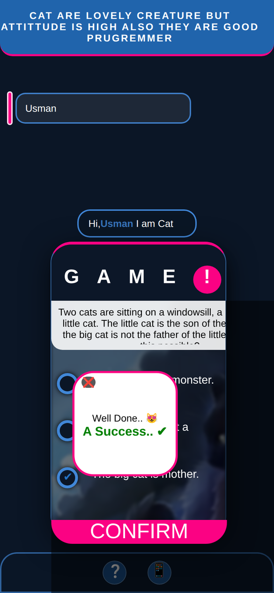
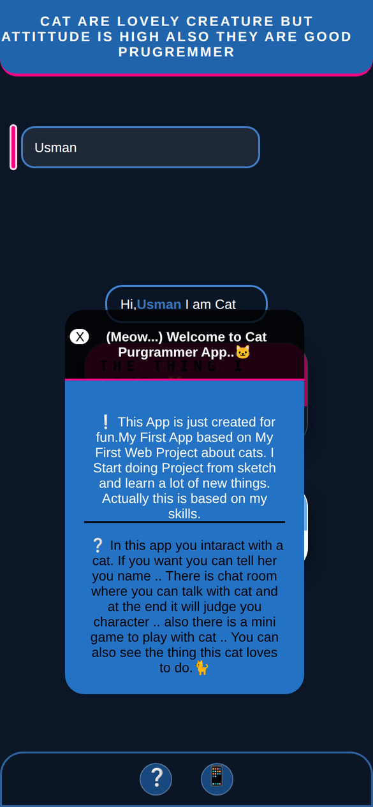
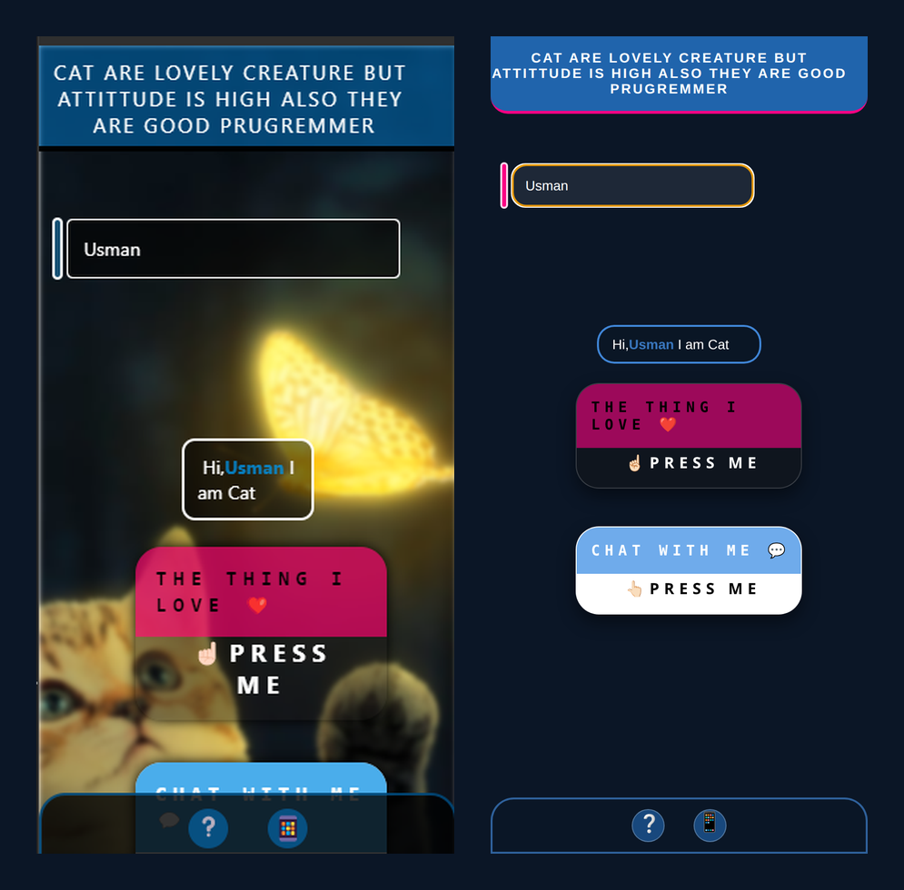
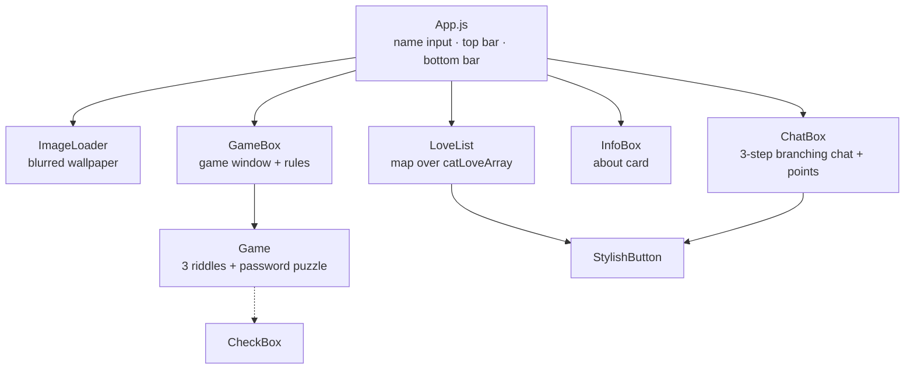

<div align="center">

# 🐱 Cat Purgrammer: My First React Native App

**Talk to a cat stuck on a rooftop, help her jump down, see what she loves, and play her riddle game.**

*My very first React Native app (December 2022), written from scratch while learning.*






</div>

---

## 💭 The story

This is where my React Native journey started. I took my first web project (a page about cats) and rebuilt it as a mobile app in **Expo Snack**, with no template or tutorial project to copy. Every component, button and state toggle in here was me figuring out how React works: `useState`, `useEffect`, props, conditional rendering, lists with `.map()`, and `StyleSheet`.

The code is kept **exactly as I wrote it** as a reminder of where I began. The only later change is a light UI polish (colors, rounded corners, shadows and spacing in the style objects). No logic, text or component changed.

## ✨ Features

| | Feature | What happens |
|---|---|---|
| 👋 | **Say your name** | Type your name and the cat greets you ("Hi, *you*, I am Cat"). The name follows you into the chat. |
| ❤️ | **The Thing I Love** | A pink card opens the cat's love list: food, favorite spot, attitude and abilities. |
| 💬 | **Chat with me** | A branching chat story. The cat is stuck on a rooftop. Pick one of 3 replies at each of 3 steps, and each choice changes her answer. |
| 🏆 | **Character result** | Every reply adds or takes away points. At the end the cat judges your character in 3 different ways. |
| 🎮 | **Mini game** | 3 cat riddles with radio-style answers, a success / try-again popup, and a final "hack MrJumpY's password" puzzle. |
| ❔ | **Info box** | An about-the-app card from the bottom bar. |
| 🎨 | **Reusable components** | `StylishButton` (a two-layer button with a "press above" hint), `ImageLoader` (blurred background image), `CheckBox`. |

## 📱 Screenshots

| Home | Love list | Chat |
|:---:|:---:|:---:|
|  |  |  |
| **Mini game** | **Right answer** | **About** |
|  |  |  |

### Then and now

The original 2022 look (left) and today's polished styles (right). Same code, new colors.

<p align="center"></p>

<details>
<summary><b>📸 The original 2022 screenshots</b></summary>
<br>

| First look | Love list | Chat box | Game box |
|:---:|:---:|:---:|:---:|
|  |  |  |  |

</details>

## 🧩 How it is built



```
myfirst_app/
├── App.js                    # main screen: name input, greeting, buttons, bottom bar
├── app.json                  # Expo config
├── src/component/
│   ├── StylishButton.js      # two-layer button used by LoveList and ChatBox
│   ├── LoveList.js           # "The Thing I Love" card
│   ├── ChatBox.js            # branching chat story with a points score
│   ├── GameBox.js            # game window, rules popup
│   ├── Game.js               # riddles + password puzzle
│   ├── CheckBox.js           # radio-style checkbox
│   ├── ImageLoader.js        # background image with blur
│   └── InfoBox.js            # about-the-app card
├── docs/screenshots/         # current screenshots
└── ScreenShots/              # original 2022 screenshots
```

**What I practised here:** state with `useState` (lots of it!), side effects with `useEffect`, passing props to reusable components, conditional rendering with ternaries, rendering lists with `.map()` and keys, `TextInput` handling, and styling with `StyleSheet` (absolute positioning, shadows, transparency).

## 🚀 Run it

```bash
git clone https://github.com/Muhammad-Usman-911/myfirst_app.git
cd myfirst_app
npm install
npx expo install react-native-web@~0.18.7 react-dom@18.0.0 @expo/webpack-config@^0.17.0
NODE_OPTIONS=--openssl-legacy-provider npm run web
```

The full guide is in **[BUILD.md](BUILD.md)**: requirements, the static web build, deploying to Vercel or Netlify, Android APK and iOS builds with EAS, and troubleshooting.

> 💡 Built for a phone screen. In the browser, switch DevTools to a phone view.

## 🗺️ If I built it again today

Ideas for a v2 (in a new branch, so this version stays as it is):

- Upgrade to the latest Expo SDK so it opens in today's Expo Go
- Turn the chat and riddles into data (arrays of steps) instead of many `useState` flags
- Use Flexbox layouts instead of negative margins, so it looks the same on every phone
- Add a local cat wallpaper (the original one loads from a site that is now offline)
- Add sound, animations (Reanimated) and a score history

## 🙏 Thank you

Thanks for visiting the place where it all started. I hope you enjoy chatting with the cat. 🐈

<div align="center">

Made with ❤️ by **[Muhammad Usman](https://github.com/Muhammad-Usman-911)**

</div>
